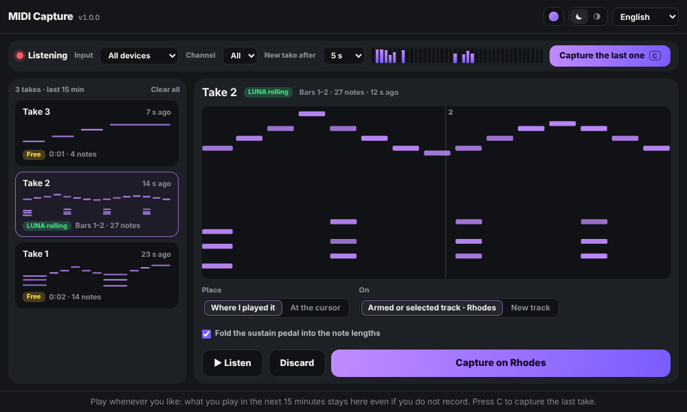
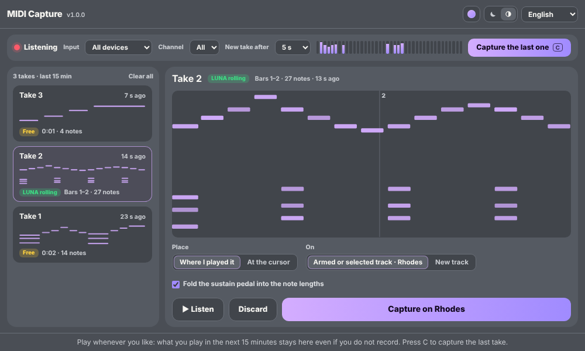

# MIDI Capture for LUNA

Never lose an idea. While its window is open, MIDI Capture keeps everything you play on your MIDI
keyboard as takes, even when LUNA is not recording, so you can listen back and capture the one
you want onto an instrument track.

  
  

## Getting started

1. Open **MIDI Capture** from **Add Ons > Windows** and leave the window open, small, in a corner.
2. Arm or select an instrument track, and play. Whatever you play is kept as a take, recording
   or not.
3. Liked it? Press **Capture the last one** (or **C**): it lands on your track. Or pick an older
   take from the list, listen to it first, and capture that one. To put it somewhere else, drag it
   out of the window (or press **Drop with a click**) and click in the arrangement, on the
   instrument track and at the spot where you want it.

The first time it opens, it asks for your language and then a short guide walks you through the
window in it; the **Guide** button brings it
back whenever you need it.

## Features

- **Always listening:** notes and the sustain pedal from all your MIDI devices, or one device and
  one channel, with LUNA playing or stopped. Nothing is recorded or changed until you capture.
- **Drop it where you want:** drag a take out of the window, or press **Drop with a click**, then
  click in LUNA's arrangement: it lands on that instrument track, at that spot. (An Add On window
  cannot drop straight onto LUNA's timeline, so the click finishes the drag.)
- **Find the right device at a glance:** the input list lights up each connected MIDI device while
  it sends, and says what it is sending (notes, CC 74, pitch bend…). Pick the one you want to
  capture, or all of them; a device that keeps sending stray messages is easy to spot and leave out.
- **Takes:** what you play becomes a take when you stop for a few seconds (5, 10, 20 or 30), or
  when LUNA starts or stops. The last 15 minutes are kept, each take with a small piano roll, how
  long ago you played it, and its notes.
- **Played with LUNA rolling:** the take knows the bars it was played over and goes back exactly
  where you played it. **Free** takes, played with LUNA stopped, go to the cursor keeping your
  timing.
- **Capture the last one:** one button, or the **C** key, puts the latest take on your track.
  Or pick any take in the list.
- **Listen first:** play a take through the instrument of the track before capturing it.
- **Where it goes:** the armed instrument track, or else the selected one, or a new track. One
  undo step.
- **Sustain pedal:** fold it into the note lengths (on by default).
- **Your colour:** yellow, orange, red, green, blue, pink or purple; dark and grey themes.
- **7 languages:** English, Español, Català, Français, Deutsch, Italiano and Português.

## Good to know

MIDI Capture listens only while its window is open, so keep it open (small, in a corner) while
you play. Takes live in the window and are cleared when you close it. It listens to MIDI devices;
LUNA's computer-keyboard MIDI may not reach it. Pitch bend and modulation are not captured yet.

## Support

If something does not work as expected, Alt-click the version number at the top of the window:
it copies a short report to paste in a message to fedetrillo@gmail.com.

## Install

Requires LUNA 3.1.2 or later. Install it from LUNA's Add On marketplace, or download
`midicapture.lunaaddon` from the latest release and double-click it. Then open a session and
choose **Add Ons > Windows > MIDI Capture**.

## En español

MIDI Capture guarda todo lo que tocas en tu teclado MIDI como tomas, aunque LUNA no esté
grabando, mientras su ventana está abierta. Escucha cualquier toma de los últimos 15 minutos y
captúrala en una pista: donde la tocaste si LUNA estaba en marcha, o en el cursor. "Capturar la
última" (o la tecla C) la manda directa a la pista. Modo oscuro y gris, siete colores, 7 idiomas.

## Licence

Copyright (c) 2026 Fede Trillo. All rights reserved. Free to install and use in LUNA; the code
may not be copied, modified or redistributed. See [LICENSE](LICENSE). The bundled LUNA Builder
SDK is Universal Audio's, under the Apache License 2.0: see
[THIRD_PARTY_NOTICES.md](THIRD_PARTY_NOTICES.md).

Contact: fedetrillo@gmail.com
